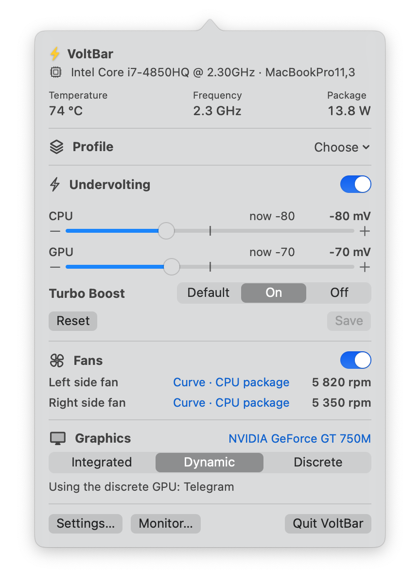
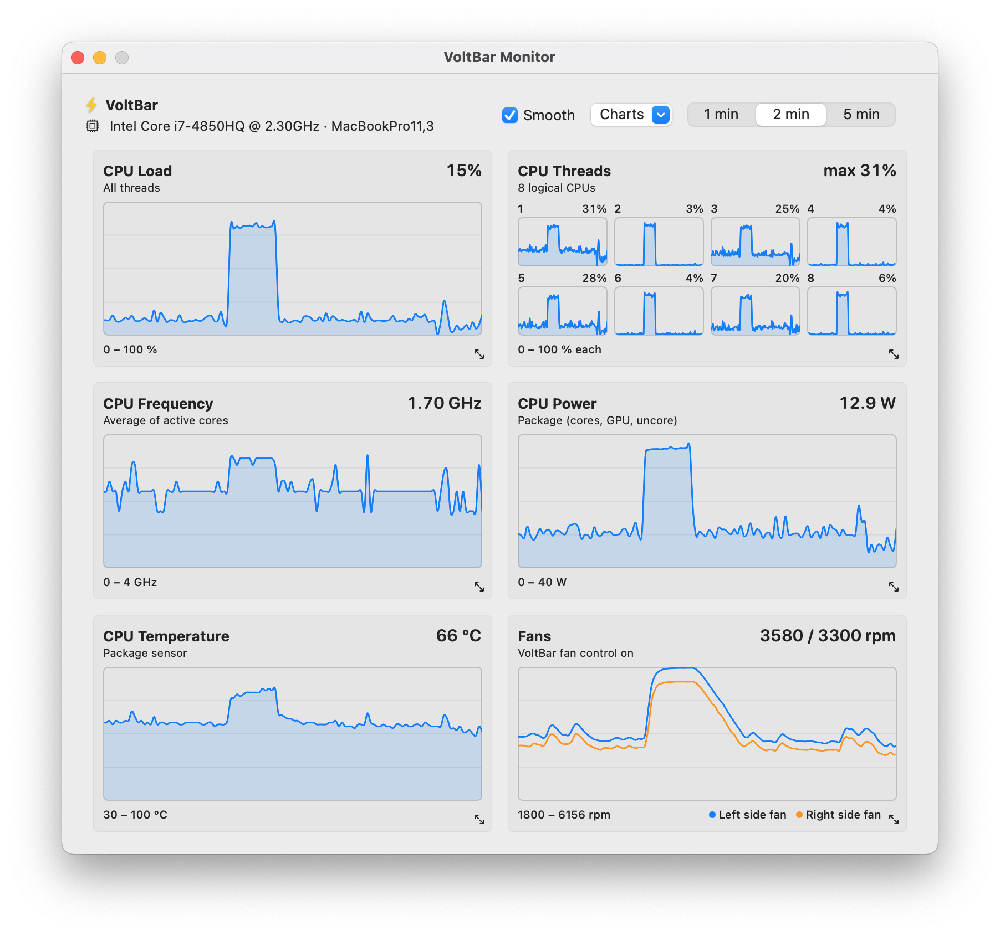
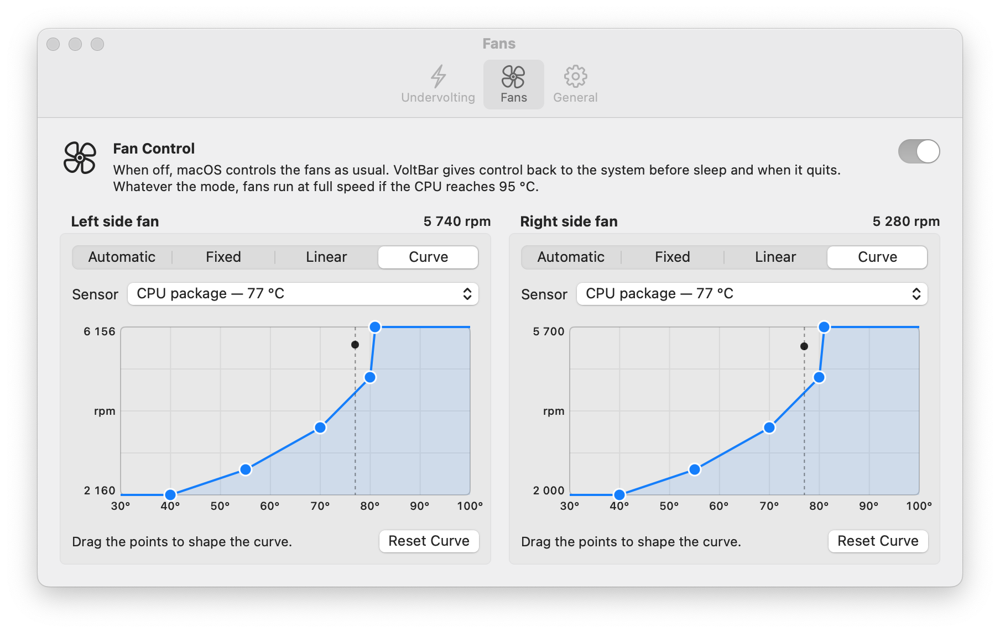
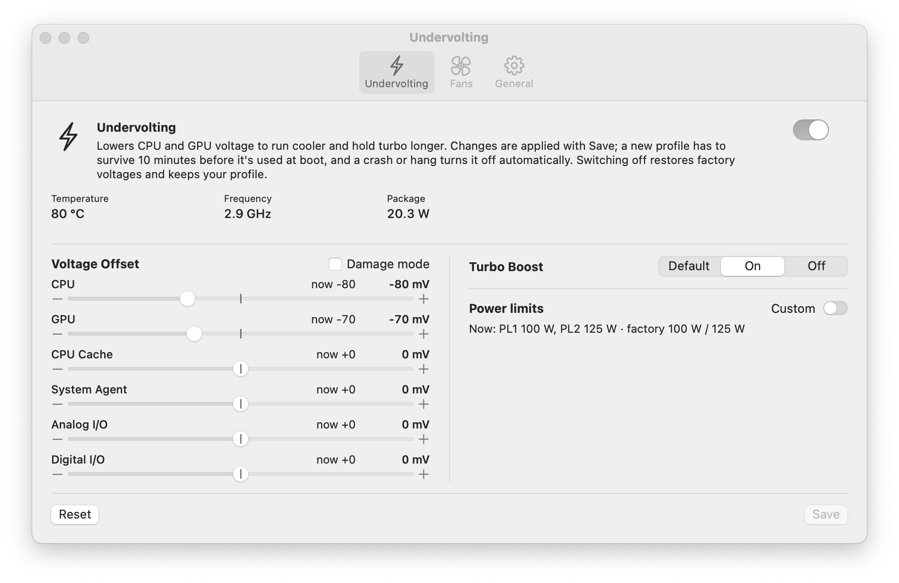
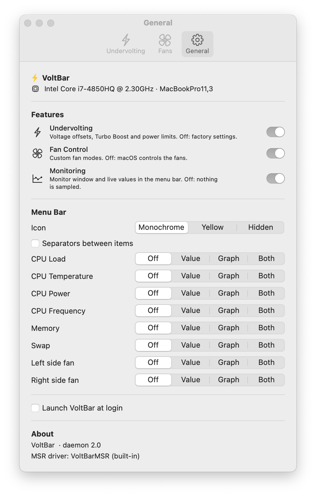

<p align="center">
  
</p>

<h1 align="center">VoltBar</h1>

<p align="center">
  <b>An alternative to <a href="https://github.com/sicreative/VoltageShift">VoltageShift</a> for Intel Macs — with fan control and hardware monitoring built in.</b><br>
  Undervolting, fan curves and live CPU / memory / fan charts, all from the menu bar.
</p>

<p align="center">
  <a href="https://github.com/wowodymyr/VoltBar/releases/latest"><b>Download the latest release</b></a>
</p>

<p align="center">
  
</p>

VoltBar does what VoltageShift does — CPU/GPU/cache voltage offsets, Turbo Boost and power limits — but as a native menu bar app with a safety net, and it replaces two more utilities on the way: **fan control** (like Macs Fan Control: fixed speeds, linear rules or curves per fan, driven by any temperature sensor) and **hardware monitoring** (like Intel Power Gadget: live charts of CPU load per thread, frequency, package power, temperature, memory, swap and fan speeds). It ships its own MSR driver (`VoltBarMSR.kext`), so VoltageShift isn't needed.

<p align="center">
  
  
</p>

<p align="center">
  
</p>

<p align="center">
  
</p>

<p align="center">
  
</p>

### At a glance

* **Menu bar app** (⚡): CPU and GPU offsets, Turbo Boost, undervolting and fan control switches, fan speeds, live temperature, frequency and package power. Settings window with all six voltage planes, power limits, per-fan modes, menu bar layout and feature modules.
* **Root daemon** `com.voltbar.daemon` (launchd) applies the profile:
  * at boot;
  * after waking from sleep or hibernation (subscribes to `IORegisterForSystemPower`, applies after 2 s and re-checks after 15 s);
  * every 30 s it checks that the values are still in place and restores them if not. VoltageShift does this once every 160 minutes by default.
* **Fan control** through the SMC and **monitoring** with a background history (see below).
* **Profiles** and **Shortcuts** actions, plus a `voltbar://` URL scheme for automation.
* **CLI** `voltbarctl` with `info`, `mon`, `offset`, `turbo`, `power`, `fans`, `profile`, `gpu`, `read`, `write` and `--damage`, just like voltageshift.

> ⚠️ This is a tool for advanced users. Too deep an undervolt causes freezes and kernel panics; raising the voltage (positive offset) can damage the CPU.

## Features (compared to VoltageShift)

| Feature | VoltageShift | VoltBar |
|---|---|---|
| Offsets for 6 planes via OC Mailbox (MSR 0x150) | `offset` | sliders / `voltbarctl offset` |
| Offset range | −250…0 mV, `--damage` to go beyond | −250…+250 mV (slider centered at 0), damage mode: −500…+500 mV |
| Turbo Boost (MSR 0x1A0, bit 38) | `turbo 0/1` | Default / On / Off |
| PL1/PL2 (MSR 0x610) | `power` | sliders / `voltbarctl power` |
| info / mon (frequency, temperature, power) | ✓ | in the menu / `voltbarctl info`, `mon` |
| read / write MSR | ✓ | `sudo voltbarctl read/write` |
| Apply at boot | `buildlaunchd` | ✓ |
| Restore after sleep and hibernation | on a timer | immediately on wake + every 30 s |
| Boot-loop and kernel-panic protection | — | ✓ (see below) |

Offsets are encoded exactly as the OC Mailbox specification defines them: in units of 1/1.024 mV. VoltageShift rounds to 1 mV, so for the same number, say −100, VoltBar sets a value about 2 % smaller in magnitude — which is exactly −100 mV.

## Graphics switching (dual-GPU MacBook Pros)

On MacBook Pros with two GPUs (for example Intel Iris Pro + NVIDIA GeForce GT 750M), **Settings → Graphics** and the menu choose which one is used — the functionality of [gSwitch](https://github.com/CodySchrank/gSwitch):

* **Integrated** — always the integrated GPU: longest battery life, least heat. If an app wakes the discrete GPU, VoltBar switches back; before forcing it while apps are using the discrete GPU, VoltBar lists them and asks (they may quit).
* **Dynamic** — macOS switches automatically (the default).
* **Discrete** — always the discrete GPU.

VoltBar shows the active GPU and the apps using (or asking for) the discrete one, can notify when the GPU changes and put a dot on the menu bar icon while the discrete GPU is active. An external display always needs the discrete GPU, so connecting one switches back to dynamic. Launch arguments work like gSwitch: `open -a VoltBar --args --integrated | --dynamic | --discrete`.

## Profiles and Shortcuts

**Settings → Profiles** saves the current undervolting, fan and graphics settings as a named profile (“Silent”, “Battery”, “Games”…). Each part is optional — a profile only changes what it includes. Apply one from the menu (**Profile**), from Settings, or automatically:

* **Automatically on power changes** (built in, works on macOS 12 and 13, which have no “Charger” trigger in Shortcuts): choose a profile for *power adapter connected* and one for *running on battery* in **Settings → Profiles → Automatic Switching**; optionally also apply it when VoltBar starts. The module can be switched off in **General → Features**.
* **Shortcuts** (macOS 13+): native actions **Apply VoltBar Profile**, **Set Graphics Mode**, **Set VoltBar Fan Control**, **Set VoltBar Undervolting** and **Open VoltBar Monitor** — use them in shortcuts and personal automations (time of day, power adapter, focus mode…).
* **Any macOS, including 12**: the `voltbar://` URL scheme, e.g. with the Shortcuts action “Open URLs”:
  `voltbar://profile/Silent`, `voltbar://gpu/integrated`, `voltbar://fans/off`, `voltbar://undervolt/on`, `voltbar://monitor`, `voltbar://settings/profiles`.
* **Terminal**: `voltbarctl profiles`, `voltbarctl profile Silent`, `voltbarctl gpu integrated`.

Profiles are stored in `~/Library/Application Support/VoltBar/profiles.json`.

## Features on demand

**Settings → General → Features** switches whole modules on or off: **Undervolting**, **Fan Control**, **Graphics Switching**, **Automatic Profile Switching** and **Monitoring**. A module that's off disappears from the menu and Settings and does nothing in the background (factory voltages, macOS fan control, no sampling). Turn it back on in the same place.

Undervolting also has its own on/off switch (menu and Settings → Undervolting), like fan control: off restores factory voltages and keeps the saved profile; on applies it again (with the usual 10-minute stability check).

## Monitor and menu bar

**Monitor…** in the menu opens live charts (1, 2 or 5 minutes) of CPU load, per-thread load, frequency, package power and temperature, memory, swap and fan speeds — a lightweight alternative to Intel Power Gadget. History is recorded in the background, so the charts are filled as soon as the window opens.

* **Smooth** (on by default): curves are interpolated and charts scroll continuously between samples; the frame rate adapts to the time span (≈20/10/4 fps) to keep CPU use low.
* **Charts** menu: show or hide each chart, including **CPU Threads** (every logical CPU as a mini chart in one card), and reset the layout.
* Charts sit in a two-column grid and are 1 or 2 cells wide and 1 or 2 cells tall: drag a chart to move it, drag its corner handle right/left and down/up to change its size (applied on release). The layout is remembered; the window scrolls if it doesn't fit the screen.

**Settings → Menu Bar** chooses which sections the menu shows (metrics, profile, undervolting, fans, graphics, Monitor button — a hidden section keeps working) and customises the status item: the ⚡ icon can be monochrome, yellow or hidden; separators can be drawn between items; every value has a fixed width, so the item never jumps as numbers change; and every metric (CPU load, temperature, power, frequency, memory, swap, each fan) can be shown as a value, a mini graph (labelled on its left), both, or not at all.

## Fan control

Off by default; switch it on in the menu (**Fans**) or in **Settings → Fans**. Each fan gets its own mode:

* **Automatic** — macOS controls the fan as usual;
* **Fixed** — a constant speed;
* **Linear** — minimum speed at or below the chosen minimum temperature, maximum speed at or above the maximum temperature, a straight line in between;
* **Curve** — a temperature → speed curve with draggable points.

Linear and Curve follow a sensor of your choice: CPU package (MSR) or any SMC sensor present on the Mac (CPU/GPU die and proximity, PCH, memory, heat pipe, palm rest, battery…). Fan settings apply immediately.

Safety: speeds stay within each fan's own min…max from the SMC; above 95 °C CPU every controlled fan runs at full speed; a fan whose sensor can't be read runs at full speed; fans are handed back to macOS before sleep, when the daemon quits and whenever it starts. CLI: `voltbarctl fans` shows fans and sensors, `voltbarctl fans off` hands control back.

## Protection against unstable undervolts

1. After **Save** the profile is applied immediately but stays unconfirmed for 10 minutes (offsets that already passed this check — or milder ones — don't need it again, so switching profiles doesn't restart it) (a countdown is shown in the menu). If the system freezes, panics or restarts during that time, the profile is **not applied** on the next boot and a warning appears in the menu.
2. **Kernel panic after saving** (even later than 10 minutes): the daemon finds the `Kernel-*.panic` report in `/Library/Logs/DiagnosticReports` and disables the profile. Unstable undervolts often crash the system at idle rather than under load (a Machine Check in `machine_idle`).
3. If the daemon starts 4 times in a row, each time running for less than 3 minutes (a boot loop), the profile is disabled as well.
4. **Hang without a panic** (hard freeze, forced power-off): the daemon records every normal exit (SIGTERM on shutdown/restart). If the previous session ended without one while a profile with voltage offsets was active, the profile is disabled on the next boot.
5. **Reset** restores 0 mV on all planes and the factory Turbo and PL1/PL2 settings, and disables the profile. The profile can be disabled even when the driver is not loaded.

If you want to restart right after saving, wait for the countdown to finish; otherwise you'll have to save the profile again. Test stability not only under load (Cinebench, Prime95) but also at idle and after waking from sleep.

## Requirements

* An Intel Haswell or Broadwell Mac, macOS 12 Monterey or newer. Tested on a MacBookPro11,3 (i7-4850HQ) with macOS 13.7; not yet tested on macOS 12.
* An unlocked OC Mailbox (patched EFI). If the menu says "OC Mailbox is not responding", voltage offsets are unavailable, but Turbo and power limits still work. On Skylake and newer the OC Mailbox is locked by Apple's firmware.
* SIP that allows unsigned kexts (OpenCore Legacy Patcher sets this up, `csr-active-config` 03080000).
* To build: Xcode or the Command Line Tools, plus Kernel.framework from the macOS SDK (included with Xcode).
* On macOS 12 the "Launch at login" checkbox creates `~/Library/LaunchAgents/com.voltbar.app.plist`; on macOS 13 and newer the system `SMAppService` is used.

### Driver: the VoltBarMSR kext

VoltBar does not depend on VoltageShift: the package includes its own driver, `VoltBarMSR.kext` (source: `Kext/VoltBarMSR.cpp`). The installer puts it into `/Library/Application Support/VoltBar/`, and the daemon loads it at startup with `kmutil load`.

Differences from VoltageShift.kext:
* only root can connect to it;
* MSR reads go through `rdmsr_carefully`: a non-existent register returns an error instead of a kernel panic;
* writes are only allowed to a whitelist of registers: OC Mailbox 0x150, PERF_CTL 0x199, MISC_ENABLE 0x1A0 (Turbo bit only), TEMPERATURE_TARGET 0x1A2 (TjMax offset only), TURBO_RATIO_LIMIT 0x1AD (never above the factory 1-core ratio), POWER_CTL 0x1FC (BD PROCHOT bit only; these three are not used by the app yet), power limits 0x610 / 0x638 / 0x640. Per-core registers are written on all cores; reserved and lock bits are masked off.

The first time it loads, macOS may ask you to allow the extension (System Settings → Privacy & Security); allow it and restart. The most robust option is to load the kext via OpenCore: copy `VoltBarMSR.kext` to `EFI/OC/Kexts/` and add an entry to `config.plist → Kernel → Add` with `BundlePath = VoltBarMSR.kext`, `ExecutablePath = Contents/MacOS/VoltBarMSR`, `PlistPath = Contents/Info.plist`, `Enabled = true`. After an OCLP update you will have to add the entry again.

If `VoltBarMSR.kext` is not installed, the daemon can fall back to `VoltageShift.kext`. The driver in use is shown in the settings window and in `voltbarctl info`.

## Installation

Download `VoltBar-<version>.pkg` from [Releases](https://github.com/wowodymyr/VoltBar/releases) and open it. The package is not signed with an Apple certificate, so the first time you may need to right-click it → **Open**. From the terminal: `sudo installer -pkg VoltBar-*.pkg -target /`.

### Building from source

```bash
git clone https://github.com/wowodymyr/VoltBar.git
cd VoltBar
./build.sh            # no sudo needed; output: build/VoltBar-<version>.pkg
open build/VoltBar-*.pkg
```

The package installs:

* `/Applications/VoltBar.app` (the app). Launch at login is a checkbox in the settings window;
* `/Library/PrivilegedHelperTools/com.voltbar.daemon` and `/Library/LaunchDaemons/com.voltbar.daemon.plist` (the daemon);
* `/Library/Application Support/VoltBar/VoltBarMSR.kext` (the driver);
* `/usr/local/bin/voltbarctl` (the CLI);
* `/Library/Application Support/VoltBar/uninstall.sh` (the uninstaller).

If VoltageShift's `com.sicreative.VoltageShift` launch daemon is found, the installer disables it, since the two daemons would fight each other. A copy of its plist is kept in `/Library/Application Support/VoltBar/`, and `uninstall.sh` offers to restore it.

To uninstall: `sudo "/Library/Application Support/VoltBar/uninstall.sh"` (it resets the voltages first).

The app icon is generated by `Tools/make-icon.swift` into `Resources/AppIcon.icns`. To redraw it, delete that file and run `./build.sh`.

## Usage

Click ⚡ in the menu bar. The compact menu has CPU, GPU, Turbo and the buttons. The other planes, damage mode, power limits and menu bar options (CPU temperature and power next to ⚡) are in the **All settings…** window. Move the sliders and press **Save**. Values are applied immediately. The "now" label shows what is actually set in hardware. The ⚡ icon is filled while a profile is active.

The CLI is handy for finding good values. Temporary settings last until restart:

```bash
voltbarctl info
voltbarctl offset -80 -50          # CPU −80, GPU −50
voltbarctl mon                     # watch frequency, temperature and power under load
voltbarctl save                    # everything is stable — make it permanent
voltbarctl reset
```

Rough guide for an i7-4850HQ: CPU around −50…−85 mV, Cache at the same level, GPU −30…−60 mV. On the test machine −100 mV on CPU passed Cinebench but caused a Machine Check panic at idle. Every CPU is different: start small and test both under load (Prime95, Cinebench, games) and at idle.

## Architecture

```
VoltBar.app / voltbarctl ──JSON over Unix socket /var/run/com.voltbar.daemon.sock (root:admin 0660)──▶ voltbard (root)
                                                                                                   │ IOConnectCallScalarMethod
                                                                                                   ▼
                                                                                     VoltBarMSR.kext (RDMSR/WRMSR)
```

* Only members of the admin group can connect to the socket. Raw MSR `read`/`write` is allowed for root only (`sudo`); with VoltBarMSR, writes are limited to the whitelist above.
* The config is stored in `/Library/Application Support/VoltBar/config.json`, internal state in `state.json`, and the log in `/Library/Logs/VoltBar.log`.

## Known limitations

* Apple also limits power through MMIO (MCHBAR). If the limit there is lower, raising PL1/PL2 via MSR may have no effect. VoltageShift behaves the same way.
* With the VoltageShift.kext fallback, the Turbo bit is written only on the core the kext runs on; VoltBarMSR writes it on all cores.

## License

GPL-3.0. VoltBarMSR.kext is part of this project. VoltageShift.kext (supported as a fallback) © sicreative, based on AnVMSR by Andy Vandijck.
